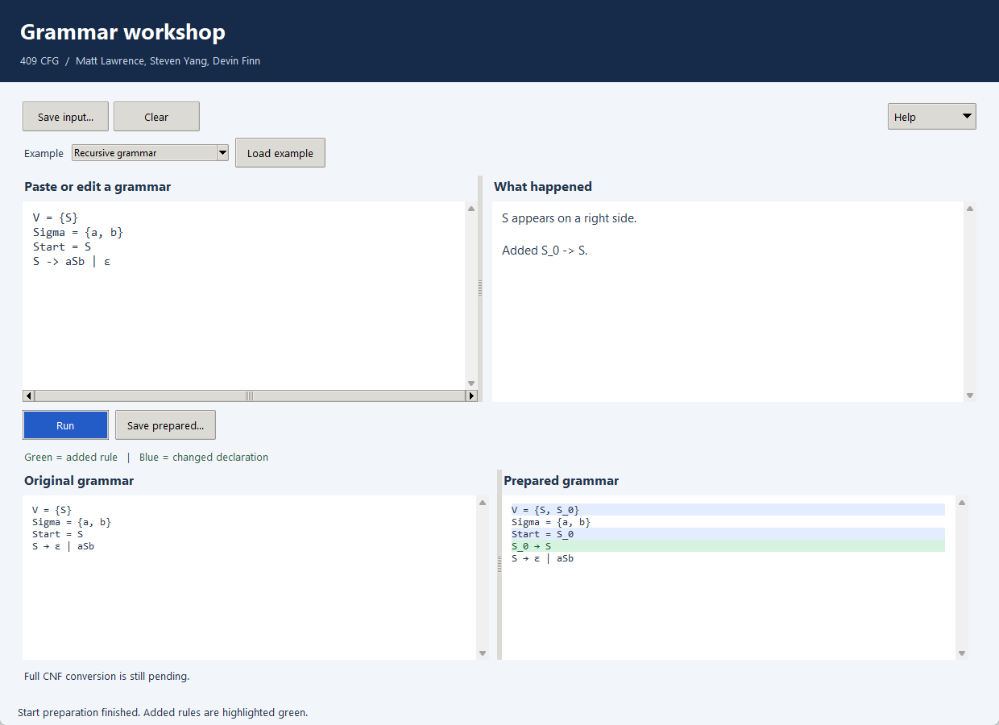

# 409 CFG

Enter a grammar, check it, and prepare its start variable.

## Team

| Member | Assigned work | Testing |
| --- | --- | --- |
| Matt Lawrence | Roles 1 and 4: grammar input, start preparation, integration, validation, docs, and demo | Leads testing |
| Steven Yang | Role 2: remove epsilon and unit productions | Helps with test cases and verification |
| Devin Finn | Role 3: remove useless symbols, replace terminals, and split long rules | Helps with test cases and verification |

## Run

Double-click **start_gui.bat**, or run:

```powershell
cd "C:\Users\mlawrence\Python Projects\Personal\409 CFG"
python3.14 gui.py
```

Use Python 3.14 with Tkinter. No extra packages needed.

## Use

1. Type or paste grammar rules, or choose an example and click **Load example**.
2. Click **Run** to check the input and prepare the start.
3. Click **Save prepared** to save the result as a `.cfg` file.

**Save input** saves your editor text. **Clear** empties the editor and results.
Editing the input clears old results, so saved output always matches the current grammar.



## Grammar notation

```text
V = {S}
Sigma = {a, b}
Start = S
S -> aSb | epsilon
```

- `V` lists variables; `Sigma` lists terminals; `Start` names the start.
- `|` separates alternatives. `epsilon` means the empty word.
- Use spaces when names could be confused: `A B` is two symbols; `AB` can be one declared name.

For a quick grammar, just enter `S -> aSb | epsilon`.

Green marks added rules. Blue marks changed declarations. If input is invalid,
the message explains what to fix and highlights the line when available.

## Learn the code

**Help > Walkthrough** follows the current grammar through the real functions.
**Help > Practice** has five short lessons, source/test viewers, and exercises.
Close Help to return to your input and results.

See [Matt Lawrence's walkthrough](STUDENT1_WALKTHROUGH.md) for the practice guide.
Teammates adding conversion code can use [INTEGRATION.md](INTEGRATION.md).

## Current progress

Grammar input, validation, and start preparation work. Matt's integration setup
and CNF checker are in place. Full conversion still needs Steven's and Devin's
transformation modules, followed by final integration and team testing.

## Tests and saved runs

```powershell
python3.14 -m unittest discover -s tests -v
```

Desktop tests need Tkinter and a display. They skip when either is unavailable.

Examples are in `examples/`; saved output and screenshots are in [sample_runs/](sample_runs/).

Steven's separate checks cover eight grammars, including nullable repeats, unit
cycles, and keeping epsilon under the prepared start. To see the cases:

```powershell
python3.14 tools/check_role2.py --list-cases
```

Run them against his module once it uses the shared `Grammar` model:

```powershell
python3.14 tools/check_role2.py src.simplify_grammar
```

His functions are still pending here. Missing code or failed checks return a
failure status. See [INTEGRATION.md](INTEGRATION.md) for the interface and expected rules.

To refresh runs and rebuild the ZIP:

```powershell
python3.14 tools/generate_evidence.py
python3.14 tools/package_handoff.py
```

For the command-line version:

```powershell
python3.14 main.py examples/lecture/03_matching.cfg
```

