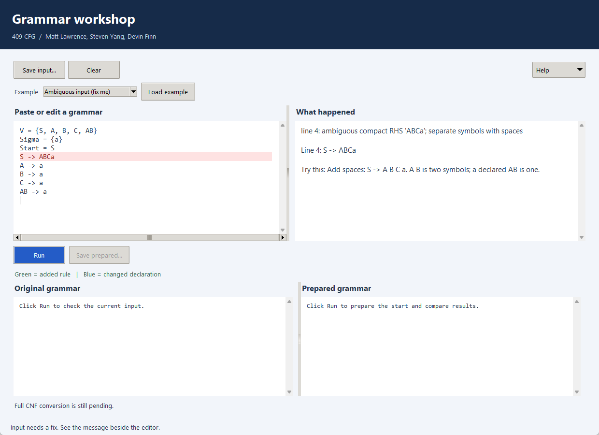

# Matt Lawrence: explain it, then try it

Open the window with `python3.14 gui.py`, or double-click `start_gui.bat`.
Everything here uses the same parser, model, and start handling as `main.py`.

Matt Lawrence owns grammar input (role 1) and leads integration, validation,
and testing (role 4). Steven Yang owns simplification (role 2), and Devin Finn
owns CNF transformation (role 3). Steven and Devin also help with testing.

## A quick demo route

1. In the main window, load **Recursive grammar**. Predict whether it needs a new
   start before clicking anything.
2. Open **Help > Walkthrough**. Read step 1, then click **Next**. The program reads
   and validates the current editor input; step 2 shows the stored tuples.
3. Click **Next** for the validation explanation, then **Next** for actual
   start preparation. Use **Show Python function** to open the code for a step.
4. Close Help. Point out `S_0 -> S`, the new start declaration,
   and the old rules that stayed in both views.
5. Reopen **Help > Walkthrough** and use **Back** to reach step 2. Explain the empty tuple.
6. Save the prepared result as `prepared.cfg`.
7. Load **No new start needed** and predict the difference.
8. Load **Ambiguous input (fix me)** and click **Run**. Read the highlighted line
   and correction tip. Replace `S -> ABCa` with `S -> A B C a`, then click **Run**.

The last example is intentionally invalid until you fix it. It is useful for
showing input validation, not a failing conversion.



## 1. Why are A B and AB different?

These are different right sides:

```python
Production("S", ("A", "B"))  # Two symbols: A followed by B.
Production("S", ("AB",))    # One symbol whose name is AB.
```

The comma in `("AB",)` makes a one-item tuple. `("AB")` is just a string.

Load **Whole names: A B vs AB**:

```text
V = {S, A, B, AB}
Sigma = {a, b}
Start = S
S -> A B | AB
A -> a
B -> b
AB -> a
```

It produces `ab` through `A B`, and `a` through `AB`. A declared whole name
wins in compact classroom notation, so the spaces matter here.

Look at `Production` in [model.py](cfg_toolkit/model.py) and
`LectureParserTests.test_exact_declared_symbol_wins_and_spaces_force_separate_symbols`
in [test_lecture.py](tests/test_lecture.py).

**Try it:** remove the `AB` alternative from S. Predict the remaining words.
Click **Run**, inspect the tuple view, and save your own `.cfg` input.

## 2. Why does epsilon become ()?

Epsilon means no symbols, so an empty tuple is a direct representation:

```python
Production("S", ())       # S -> epsilon
Production("S", ("e",))  # S -> e, a one-symbol right side
```

The reader converts its supported epsilon spellings
to `()`. Plain `e` stays an ordinary terminal.

Look at `_read_rhs()` in [lecture.py](cfg_toolkit/lecture.py) and
`LectureParserTests.test_bare_e_is_an_ordinary_terminal` in
[test_lecture.py](tests/test_lecture.py).

**Try it:** load the matching example, change epsilon to `e`, and add `e` to
Sigma. Explain why the empty word is gone and `e` can now be produced. Reload
the original example when finished.

## 3. Why keep earlier grammars unchanged?

The program needs both the original and the result for comparison and later
language checks. `Grammar` and `Production` are frozen dataclasses. Their sets
are frozen and their right sides are tuples.

That means a transformation creates a new `Grammar`. It cannot quietly change
an earlier snapshot. If start preparation has nothing to change, returning the
same original object is safe.

Look at `Grammar` in [model.py](cfg_toolkit/model.py) and
`StartSymbolTests.test_original_is_unchanged_and_preparation_is_idempotent`
in [test_start_symbol.py](tests/test_start_symbol.py).

**Try it:** add a test assertion that the original start is still `S` after
preparation gives the result a start named `S_0`. Explain what would break if
both views pointed to the same mutable object and that object was edited.

## 4. When is a new start needed?

Our CNF convention keeps the start off every right side.

```text
S -> aSb | epsilon
```

This needs a new start because S occurs on the right:

```text
S_0 -> S
S -> aSb | epsilon
```

Every old rule stays. If `S_0` is already a variable or terminal, the program
tries `S_1`, `S_2`, and so on. If S never appears on a right side, no wrapper is
needed, even when it produces epsilon.

Steven Yang will later remove the temporary unit rule and handle epsilon for the
prepared start. This step alone is not the finished CNF conversion.

Look at `prepare_start()` in [start_symbol.py](cfg_toolkit/start_symbol.py) and
`StartSymbolTests.test_name_collision_checks_variables_and_terminals`
in [test_start_symbol.py](tests/test_start_symbol.py).

**Try it:** write a new test using a start named `Begin`, with `Begin_0` already
taken. Predict the fresh name before running the test.

## 5. How does a test catch the wrong answer?

The real recursive-start test includes:

```python
self.assertFalse(result.grammar.start_on_rhs)
```

If a broken implementation returns the original recursive grammar, its start
still appears on a right side. The expression is `True`, so the test fails.
Other assertions check the fresh name, the exact added rule, and the old rules.
Together, those checks catch more mistakes than simply checking for no crash.

In **Help > Practice**, choose **Catch a wrong result** and click **Run
test demonstration**. It uses a real `unittest` assertion on a deliberately
wrong result, then on the real `prepare_start()` result. The first fails and
the second passes. It never edits or replaces the real implementation.

Open `StartSymbolTests.test_recursive_nullable_start_gets_fresh_wrapper` in
[test_start_symbol.py](tests/test_start_symbol.py). Explain what each assertion
would catch.

**Try it:** add your own test for a right side containing the start twice.
Run the focused tests:

```powershell
python3.14 -m unittest discover -s tests -p test_start_symbol.py -v
```

## Small changes teammates can make themselves

Pick a task, make the change, and explain the result to someone else:

| Task | What to show afterward |
| --- | --- |
| Add a new input fixture in `examples/practice/` | Predicted rules, expected start, and one focused test |
| Add the `Begin` name-collision case | Expected fresh name and passing test output |
| Improve one correction tip in `gui_support.py` | Before/after message and a test using the actual invalid input |
| Add a walkthrough example to `EXAMPLES` in `gui.py` | The loaded grammar, validation result, and explanation of its purpose |

## Team responsibilities

| Member | Assigned roles | Main work | Testing |
| --- | --- | --- | --- |
| Matt Lawrence | 1 and 4 | Input, representation, start handling, integration, CNF validation, docs, and demo | Leads the final test and verification work |
| Steven Yang | 2; testing support for 4 | Epsilon and unit-production removal | Helps with simplification cases and integration tests |
| Devin Finn | 3; testing support for 4 | Useless-symbol removal, terminal replacement, and binary rules | Helps with CNF cases and integration tests |

These are role assignments. Record actual changes, test runs, and commits as
the work is done. Keep the final contribution statement tied to those records.

## What these checks establish

Input checks establish that a grammar is well formed. Start tests check the
preparation rules and preservation of short generated words. The final CNF
validator checks rule shapes and optional source epsilon membership. Finite
language checks help find bugs; they do not prove equivalence for every string.
